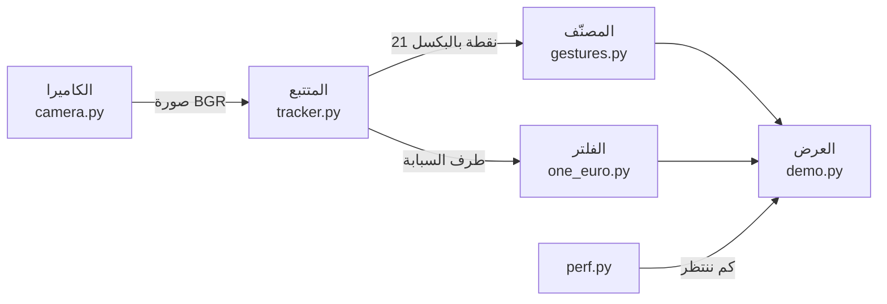

# المرحلة 1: المحرك

## شنو بنينا وليش؟

تخيّل مترجم واكف بين يدك والكمبيوتر: يشوف يدك بالكاميرا، يحدد مكان كل مفصل، ويكول "هذا قرص" أو "هذه قبضة". هذا هو **المحرك**. الوحدتين (الويب والويندوز) راح يستخدمونه، فلازم يكون دقيق وسريع وما يرجف.

السلسلة كلها:

## الملفات واحد واحد

### `engine/gestures.json` — الإعدادات المشتركة
كل الأرقام اللي ممكن تغيرها بمكان واحد. Python و JavaScript يقرون نفس الملف، فإذا غيرت `pinch_enter` يتغير بالاثنين.

| الإعداد | معناه |
|---|---|
| `pinch_enter` 0.25 | القرص "يتسكّر" إذا المسافة أقل من ربع حجم الكف |
| `pinch_exit` 0.35 | وما "ينفتح" إلا إذا صارت أكثر من 0.35 (شوف Hysteresis) |
| `debounce_frames` 3 | الإيماءة لازم تتكرر 3 إطارات ورا بعض حتى نصدقها |
| `extend_ratio` 1.1 | الإصبع "ممدود" إذا طرفه أبعد عن الرسغ من مفصله الوسطي بـ 10% |
| `curl_ratio` 0.9 | الإصبع "ملفوف بالكف" إذا طرفه أقرب من مفصله (ما نحسبه قرص) |

### `one_euro.py` — فلتر التنعيم
**المشكلة:** النموذج ما يعطي نفس المكان بالضبط كل إطار حتى لو يدك واكفة، فالمؤشر يرجف.
**الحل الساذج:** نأخذ المعدل، بس هذا يخلي المؤشر يتأخر ورا يدك وكأنه "مطاطي".
**One Euro:** يغيّر قوة التنعيم حسب السرعة. مثل الكاميرا اللي تثبّت الصورة: إذا إيدك ترجف شوية يثبّتها، وإذا تحركت فعلاً يلحك وياك.
- `_alpha(cutoff, dt)`: يحوّل "شكد ننعّم" لنسبة خلط بين القيمة القديمة والجديدة.
- `filter(x, t)`: يحسب السرعة، ومنها يحسب الـ cutoff، ويرجع القيمة المنعّمة.
- `reset()`: ننسى الماضي (لما اليد تطلع من الصورة، حتى ما يزحف المؤشر من مكانها القديم).

### `gestures.py` — مصنّف الإيماءات
- `hand_size(pts)`: طول الكف من الرسغ (0) لقاعدة الوسطى (9). كل المسافات نقسمها عليه، فيدك قريبة أو بعيدة تعطي نفس النتيجة.
- `pinch_ratio(pts, tip)`: مسافة طرف الإبهام عن طرف إصبع ÷ حجم الكف.
- `is_extended(pts, finger, ratio)`: هل الإصبع ممدود؟
- `GestureClassifier.classify(pts)`: القواعد بالترتيب: قبضة ← قرص ← قرص وسطى ← كف مفتوحة ← إصبعين ← ولا شي. **الترتيب مهم**: نفحص القبضة أول لأن بالقبضة الإبهام لازك بالسبابة بالصدفة.
- `update(pts)`: يضيف الـ debounce فوك `classify`.

### `camera.py` — الكاميرا
- `Camera`: تفتح الكاميرا بـ DirectShow، وتفرّق بين "ماكو كاميرا" (`NOT_FOUND`) و "محجوزة" (`BUSY`: تنفتح بس ما تعطي صور) و "انقطعت بالنص" (`LOST`). الصورة تنعكس مثل المراية حتى تحرك يدك يمين ويتحرك المؤشر يمين.
- `LatestFrameReader`: خيط بالخلفية يقرأ الكاميرا (شوف Thread). **هذا رفع السرعة من 15 لـ 30 fps.**
- `frame_quality`: يصغّر الصورة لـ 80x60 ويحسب متوسط الإضاءة.

### `tracker.py` — المتتبع
- `HandTracker`: يلف MediaPipe `HandLandmarker` بوضع `VIDEO` (يستفيد من الإطار السابق). يحوّل النقاط من نسب (0 إلى 1) لبكسل، حتى x و y يصيرون بنفس المقياس (لأن الصورة 640 عرض و 480 طول، فالنسب وحدها تشوّه المسافات).
- `hand_unclear`: اليد مكصوصة على الحافة أو صغيرة هواية.

### `perf.py` — الأداء
- `AdaptiveRate.next_interval`: 30 fps مع يد، 5 fps إذا ماكو يد أكثر من ثانية، 15 إذا المعالج فوك 25%.
- `CpuMeter`: استهلاكنا كنسبة من المعالج كله (مثل مدير المهام).
- `set_below_normal_priority`: نكول للويندوز إن برامجك الثانية أهم.

### `demo.py` و `record_fixture.py`
- `demo.py`: يجمع كلشي ويرسم. `--bench 60` يقيس بدون نافذة.
- `record_fixture.py`: يحفظ نقاط يدك (أرقام بس، بدون صورة) كملف اختبار.

### `engine/js/` — نفس المحرك بـ JavaScript
`gestures.js` و `one_euro.js` نسخة طبق الأصل، و `gestures.test.js` يمر على نفس ملفات `engine/fixtures`. هذا اللي يخلي "المحرك واحد" رغم إنه بلغتين.

## الأرقام المقاسة على جهازك (Ryzen 7 5800H)

| الحالة | FPS | CPU (من المعالج كله) |
|---|---|---|
| يد وحدة (`num_hands=1`) | ~30 | ~5–6% |
| يدين (`num_hands=2`) | ~18–23 | أعلى |
| ماكو يد (وضع الراحة) | 5 | ~1–1.5% |

الكاميرا نفسها أحياناً تنزل لـ 15 fps بالضوء الضعيف (تعريض تلقائي). هذا من العتاد.

## شلون يشتغل المبرمج؟ (اللي صار فعلاً بهالمرحلة)

1. **اختبار أول، كود بعدين (TDD):** كتبنا `test_one_euro.py`، شغلناه وفشل بـ `No module named 'airengine.one_euro'` (أحمر)، بعدها كتبنا الكود ونجح (أخضر). صراحةً: بـ `perf.py` ونسخة JS كتبت الاختبار والكود سوه بدون ما أشغّل الأحمر أول، وهذا تقصير صغير.
2. **قراءة رسالة الخطأ:** اختبار `none` فشل وكال `MIDDLE_PINCH == NONE`. ما غيرنا الرقم عشوائياً؛ سألنا "ليش الإبهام قريب من الوسطى؟" ← لأن الوسطى ملفوفة بالكف. فأضفنا قاعدة `curl_ratio`. هذا خطأ كان راح يصير بيدك الحقيقية.
3. **قِس، لا تخمّن:** السرعة كانت 15 fps. بدال ما نخمن، قسنا كل جزء: الكاميرا 33ms + النموذج 33ms. فعرفنا الحل (Thread). بعدها قسنا مرة ثانية ولكينا إن يدين = أبطأ.
4. **ارجع إذا الدليل يكول غلط:** جربنا نطلب من الكاميرا 30 fps وصارت أسوأ (15 ثابت)، فرجعنا التغيير وكتبنا ملاحظة ليش.
5. **اكتشفت غلطي بنفسي:** استخدمت `handedness.score` كـ "وضوح اليد"، بس هو ثقة "يسار أو يمين". بدلناه بقاعدة حقيقية.
6. **Commit بعد كل خطوة:** شوف `git log --oneline`.

## مفاهيم برمجية جديدة

- **class:** قالب نصنع منه أشياء إلها بيانات ودوال. `f = OneEuroFilter()` يصنع فلتر، و `f.filter(5, 0)` يستخدمه. كل فلتر يتذكر ماضيه لحاله.
- **Enum:** قائمة قيم ثابتة بأسماء. `Gesture.PINCH` أوضح وأأمن من كتابة `"pinch"` بإيدك (غلطة إملائية = خطأ واضح).
- **Exception (استثناء):** طريقة "نصرخ" إن صار خطأ. `raise CameraError("BUSY")` يوقف ويرجع للي يمسكه بـ `try/except`.
- **Thread (خيط):** عامل ثاني داخل نفس البرنامج يشتغل بالتوازي. `threading.Thread(target=fn, daemon=True).start()`.
- **Event:** جرس بين الخيوط: واحد يسوي `set()` والثاني ينتظر بـ `wait()`.
- **dataclass:** class بسيط بس يحمل بيانات. `Hand(landmarks, handedness, score)`.
- **Dependency injection (حقن الاعتماد):** `Camera(opener=...)` نمرر الدالة اللي تفتح الكاميرا، فبالاختبار نمرر كاميرا وهمية.
- **`export`/`import` (JS):** ملف يصدّر دوال وملف ثاني يستوردها.

## 5 نقاط لازم تفهمها

1. اليد عند MediaPipe = 21 نقطة مرقّمة (0 الرسغ، 4 طرف الإبهام، 8 طرف السبابة...).
2. الإيماءات = قواعد هندسية بسيطة على المسافات، مقسومة على حجم الكف حتى ما تتأثر بالبعد.
3. Hysteresis و Debounce يمنعون الرمشة: عتبتين مختلفتين، وتكرار 3 إطارات.
4. One Euro ينعّم بقوة لما اليد بطيئة، وبخفة لما سريعة.
5. السرعة تجي من القياس: Thread للكاميرا، يد وحدة، و 5 fps وقت الراحة.

## 3 أسئلة

1. ليش نقسم مسافة القرص على `hand_size` بدل ما نستخدم المسافة بالبكسل مباشرة؟
2. إذا `pinch_enter` و `pinch_exit` صاروا نفس الرقم (0.3)، شنو المشكلة اللي راح تصير؟
3. ليش البرنامج أسرع لما نتتبع يد وحدة بدل يدين؟

## تمارين اختيارية

1. غيّر `pinch_enter` لـ 0.15 بـ `gestures.json`، شغّل الـ demo، وشوف شكد لازم تقرّب أصابعك.
2. غيّر `debounce_frames` لـ 1 وبعدين لـ 10. شنو الفرق بالإحساس؟
3. سجّل قرصك الحقيقي: `python -m airengine.record_fixture real_pinch PINCH` وشغّل `pytest`. إذا فشل، شوف `pinch_ratio` شكد طلع.
4. غيّر `beta` بفلتر One Euro لـ 0 وشوف الدائرة البنفسجية شلون تتأخر ورا إصبعك.
