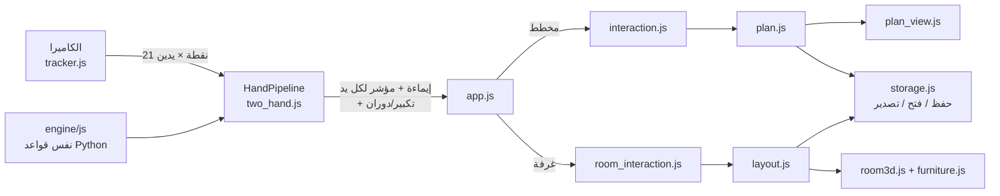

# المرحلة 2: AirStudio Design (الاستوديو بالمتصفح)

## شنو بنينا وليش؟

صفحة ويب تفتحها من أي رابط، تشوف إيدك بالكاميرا، وتخليك:
1. ترسم مخطط غرفة على ورقة بيضاء بالقرص (مثل ما ترسم بقلم بالهوا).
2. تفتح الغرفة 3D وتحط بيها أثاث وتحركه وتدوره بإيدك.
3. تحفظ شغلك تلقائياً، وتصدّره ملف أو صورة وتشاركه.

كلشي يصير داخل متصفحك: ماكو سيرفر يشوف صورتك، والمكتبات والنموذج محفوظة داخل المشروع، فالصفحة ما تحتاج إنترنت بعد ما تنفتح.

## فكرة مهمة: الكود "النقي" والكود اللي يرسم

قسمنا كل ميزة لملفين:
- **نقي** (`plan.js`, `interaction.js`, `layout.js`, `room_interaction.js`, `two_hand.js`, `storage.js`): حسابات بس. "إذا قرصت هنا وسحبت لهناك، شكد جدار صار؟". ما يعرف شي عن الصفحة ولا الكاميرا.
- **رسم** (`plan_view.js`, `room3d.js`, `app.js`, `room_mode.js`): يرسم ويربط الأزرار.

الفايدة: الكود النقي نختبره بـ `node` بأجزاء من الثانية (70 اختبار)، بدون متصفح. مثل ما تجرب وصفة الطبخ على الورق قبل ما تشعل الطباخ.

## الملفات واحد واحد

### الإدخال (اليد ← أرقام)
- **`tracker.js`**: يفتح الكاميرا (`getUserMedia`) ويشغّل MediaPipe. يحوّل أخطاء المتصفح لرسائلنا (`NotAllowedError` ← `DENIED`...). `numHands: 'auto'`: يدين على كارت الشاشة، يد وحدة على المعالج (قرارك بعد القياس).
- **`two_hand.js`**:
  - `matchHands`: MediaPipe ما يضمن نفس الترتيب كل إطار، فنعطي كل يد رقم حسب أقرب مكان للإطار السابق.
  - `TwoHandGesture`: التكبير = المسافة الحالية ÷ المسافة ببداية الإيماءة؛ الدوران = فرق الزاوية.
  - `HandPipeline`: يجمع كلشي: لكل يد مصنّف إيماءات وفلتر One Euro من `engine/js` (نفس محرك المرحلة 1).
- **`hands.js`**: الحلقة اللي تشتغل مع كل إطار كاميرا (`requestVideoFrameCallback`)، وضع الراحة (5 فحوصات بالثانية بدون يد)، فحص الإضاءة، وقياس fps الكاميرا الفعلي.

### المخطط
- **`plan.js`**: جدران وخطوط حرة بالمتر. `snapWall` يلصق على شبكة 10 سم، زوايا 15°، وزوايا موجودة (مغناطيس 30 سم). `checkpoint/undo` = نسخة قبل كل تغيير.
- **`interaction.js`**: قرص+سحب = جدار؛ كف تتحرك = ممحاة تمسح على طول الطريق؛ كف ثابتة 1.5 ث = إيقاف.
- **`plan_view.js`**: يرسم على canvas، والماوس كبديل.

### الغرفة 3D
- **`layout.js`**: مقاسات الأثاث الحقيقية، `footprint` (المساحة بعد الدوران)، `clamp` (داخل الجدران)، `hitTest` (شنو تحت المؤشر).
- **`room_interaction.js`**: قرص على القائمة ← سحب ← إفلات = قطعة جديدة؛ قبضة على قطعة = تحريك؛ يدين = تدوير القطعة أو الكاميرا؛ كف ثابتة ثانية فوك قطعة = حذف.
- **`furniture.js`**: كل قطعة من صناديق واسطوانات.
- **`room3d.js`**: المشهد، الكاميرا، الإضاءة، الجدران الشفافة، وتحويل نقطة الشاشة لنقطة على الأرض (Raycasting).
- **`room_mode.js`**: يربط هذا كله ويه الأزرار والماوس.

### الحفظ
- **`storage.js`**: `serialize` (التصميم ← JSON)، `parseDesign` (JSON ← تصميم بعد فحص صارم)، `applyDesign`.

## الأرقام المقاسة على جهازك

| الحالة | وقت النموذج |
|---|---|
| يد + GPU | 16.0 ms |
| يدين + GPU | 22.9 ms |
| يد + CPU | 46.0 ms |
| يدين + CPU | 90.3 ms |

الكاميرا عطت ~14 fps بكل الحالات (الضوء)، يعني الكاميرا هي السقف مو التتبع. **قياس الاستوديو كامل (التتبع + الرسم 3D سوية) بعده عليك**: افتح الرابط ويه `?perf` (شوف التمارين).

## شلون يشتغل المبرمج؟ (اللي صار فعلاً بهالمرحلة)

1. **قِس قبل ما تقرر:** بنينا `bench.html` قبل أي تصميم. وأنت لاحظت شي فاتني: الـ fps ثابت بكل الحالات، فالمعيار الصحيح وقت النموذج مو الـ fps.
2. **اقرا الخطأ لحد آخره:** `Failed to fetch dynamically imported module` أشّر على `tracker.js`، بس الكونسول كال السبب الحقيقي: `MIME type of "text/plain"` لملف `.mjs`. الحل: غيّرنا الامتداد (يشتغل ويه أي سيرفر)، مو رقعة بسيرفر وحد.
3. **الاختبار الفاشل يعلّمك:** `real_pinch.json` فشل. الأرقام كالت إنها كف مفتوحة (0.584)، فالمشكلة بأداة التسجيل (تحفظ أول إطار)، مو بالمصنّف.
4. **غلطة مني:** سويت commit والاختبار فاشل. بعدها صار الأمر نفسه يرفض الـ commit إذا في فشل.
5. **"المسح يقفز":** اختبار الممحاة فشل لأن الكف تحركت أسرع من الجدار. ما غيرنا الاختبار؛ صلحنا الممحاة تمسح على طول الطريق، لأن نفس الشي يصير بإيد حقيقية.
6. **مشكلة ما انحلت (وهذا طبيعي):** "الورقة تختفي". قسنا 3 أحجام × 3 مقاييس: ما تكررت. الوضع الداكن الإجباري بـ Chrome كررها. جربنا 3 حلول وفشلت كلها، فوقفنا (قاعدة: بعد 3 محاولات فاشلة، شك بالفرضية نفسها) ورجّعنا التغييرات، وطلبنا دليل من متصفحك.
7. **لا تصدّق مصدر واحد:** صورة الشاشة كالت الخطوة 2، وحالة الصفحة كالت 3. طلع المتصفح مخفي والصورة قديمة.
8. **الاختبار لازم يكدر يفشل:** الاختبار البصري شغلناه ويه الوضع الداكن حتى نتأكد إنه يفشل فعلاً. واختبار اليد الثانية رجّعنا الكود القديم وتأكدنا إنه يفشل بدون الإصلاح.
9. **المراجعة:** code-review لكى 9 أشياء (أهمها تسريب ذاكرة كارت الشاشة بكل تبديل للغرفة)، وكلها انصلحت.

## مفاهيم جديدة

- **async / await:** `await openCamera(video)` = "انتظر النتيجة بدون ما تجمّد الصفحة".
- **ES modules (`import` / `export`):** كل ملف يصدّر دواله، والثاني يستوردها. `import('./room3d.js')` بنص الكود = تحميل وقت الحاجة (three.js ما ينحمّل إلا لما تفتح الغرفة).
- **MIME type:** ملصق يرسله السيرفر ويه كل ملف يكول نوعه. المتصفح يرفض يشغّل كود ملصقه "نص عادي".
- **localStorage:** دفتر صغير يحفظ بيه المتصفح معلومات لموقعك.
- **Canvas:** لوحة رسم بالصفحة ترسم عليها بالكود.
- **WebGL / three.js:** رسم 3D بكارت الشاشة. three.js يسهّله: مشهد + كاميرا + أشكال + إضاءة.
- **Raycasting:** نطلق "شعاع" من الكاميرا عبر نقطة الشاشة ونشوف وين يضرب الأرض. هيج نعرف وين إيدك "واكفة" بالغرفة.
- **Trust boundary:** وين تدخل بيانات من برة (ملف من صديق). نفحص كل حقل ونبني نسخة بالحقول اللي نعرفها بس.
- **Pure function / كود نقي:** ما يعتمد على الصفحة ولا الوقت ولا الكاميرا؛ نفس المدخل = نفس النتيجة دايماً، فيسهل اختباره.
- **E2E test:** اختبار من أول لآخر بمتصفح حقيقي، يضغط أزرار ويحقن أيادي مثل المستخدم.

## 5 نقاط لازم تفهمها

1. الاستوديو يستخدم نفس محرك المرحلة 1 (`engine/js`)، فقواعد الإيماءات وحدة بالويب و Python.
2. كل ميزة = كود نقي يتختبر بسرعة + كود رسم رفيع.
3. كل حركة بالإيد إلها "بداية وإفلات"، وإذا اليد اختفت بالنص نلغي بدل ما ننفّذ شي ما قصدته.
4. أي ملف جاي من برة مشكوك بيه لحد ما يعبر الفحص.
5. الاختبار اللي ما شفته يفشل مرة، ما تعرف إذا يفحص شي فعلاً.

## 3 أسئلة

1. ليش الجدار ينتهي بآخر نقطة وانت قارص، مو بنقطة الإفلات؟
2. شنو يصير لو ما فحصنا الأرقام بملف JSON وواحد بعثلك ملف بيه جدار عند x = 1,000,000,000؟
3. ليش الممحاة ما تمسح لما الكف ثابتة؟

## تمارين اختيارية

1. **قِس الاستوديو:** افتح `http://127.0.0.1:8765/web-studio/?perf`، شغّل الكاميرا، روح للغرفة 3D وحرّك يدينك. شوف "نموذج" و "إطار" فوك مراية الكاميرا. الفرق بيناتهم = وقت الرسم.
2. غيّر `GRID` بـ `plan.js` من 0.1 لـ 0.5 وارسم. شنو تغيّر؟
3. غيّر مقاس الكنبة بـ `FURNITURE` بـ `layout.js` لـ 3 متر، وشغّل `npm test`. أي اختبار فشل وليش؟
4. افتح ملف `airstudio-design.json` اللي صدّرته، غيّر `"chair"` لـ `"piano"`، وافتحه بالاستوديو. شنو الرسالة؟
5. شغّل `npm run test:visual` وشوف Chrome يختبر الصفحة لحاله (أسرع من إيدك!).
