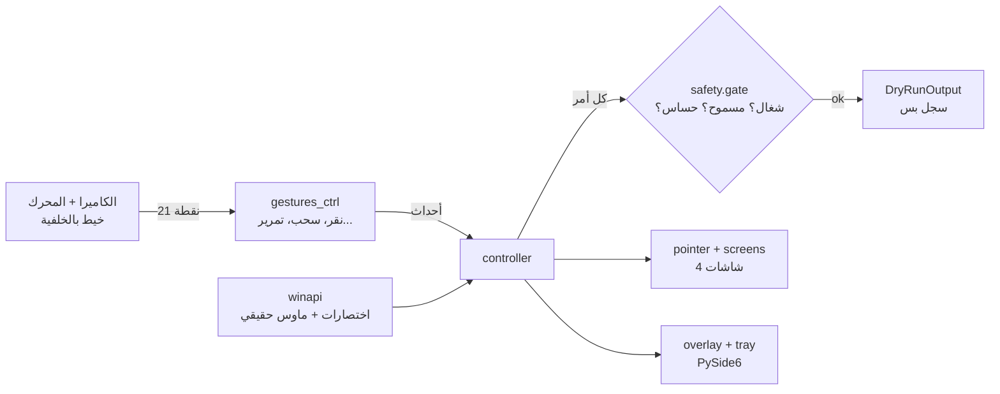

# المرحلة 3: AirControl بوضع Dry-run (تجريبي)

## شنو بنينا وليش؟

برنامج ويندوز يحوّل إيدك لماوس وكيبورد. بهاي المرحلة **يرسم ويعرض بس**: تشوف المؤشر يتحرك فوق شاشاتك، والأوامر تنكتب بالسجل ("نقر عند (2310, 540)")، بس **ولا أمر يوصل لويندوز**. مثل ما تتدرب على السياقة بمحاكي قبل الشارع.

## الملفات واحد واحد

- **`actions.py`**: القائمة البيضاء. كل أمر مسموح بالاسم، و`validate()` ترفض أي شي ثاني. فيه اختبار شامل يتأكد ماكو أمر مسموح يضغط مفاتيح خطرة (Alt+F4، Win+R...).
- **`bindings.py`**: ملف إعداداتك (أي إيماءة تسوي أي أمر). نعامله مثل ملف من غريب: أي سطر غلط = نرفض الملف كله. القبضة (إيقاف) والكفين (تفعيل) ما تتغير أبداً.
- **`safety/state.py`**: البوابة. مطفي ← شغال ← موقف (لمست الماوس) ← شغال، والإيقاف الطارئ من أي حالة.
- **`screens.py`**: سطح المكتب الافتراضي. اكتشفنا إن عندك **4 شاشات** بأحجام وتكبير مختلف، وحدة منها على اليسار بإحداثيات سالبة.
- **`pointer.py`**: لوحة لمس بالهوا (نسبي + تسارع)، مطلق، دقة، رفع الماوس، وقفل النقر.
- **`gestures_ctrl.py`**: الإيماءات **الزمنية**. النقرة مو "شكل يد"، هي "لمسة قصيرة". فنحسب المدة: أقل من 250 ms = نقر، أكثر من 350 ms = سحب، وبيناتهم = لا شي (حتى ما نغلط).
- **`radial.py` و `keyboard.py`**: القائمة الدائرية ولوحة المفاتيح (حساب بس).
- **`controller.py`**: يربط كلشي. كل أمر يعبر البوابة.
- **`winapi.py`**: الشاشات، الاختصارات العامة، وكشف الماوس الحقيقي (ويندوز يحط علامة INJECTED على الإدخال الوهمي، فنميّزه).
- **`ui/overlay.py`**: طبقة شفافة فوق كل شاشة، ما تمسك الماوس.
- **`app.py`**: يشغّل كلشي: الكاميرا بخيط، الطبقات، الـ tray.

## مفاهيم جديدة

- **آلة حالات (State machine):** البرنامج يكون بحالة وحدة بكل وقت (مطفي/شغال/موقف)، وأحداث محددة تنقله. مثل إشارة المرور.
- **إيماءة زمنية:** تعتمد على الوقت مو على صورة وحدة. `t - contact_t0 < 0.25` = نقر.
- **Hook:** ويندوز يخبرنا بكل حركة ماوس وضغطة كيبورد بالجهاز، حتى نعرف إذا لمستهم.
- **DPI / Per-Monitor DPI Aware:** شاشة 175% تعرض كلشي أكبر. البرنامج "الواعي" يشتغل بالبكسل الحقيقي حتى ما تتخربط الحسابات بين شاشة 175% وشاشة 100%.
- **Signal (إشارة Qt):** الطريقة الآمنة حتى خيط الكاميرا يكلّم الواجهة.
- **كتابة ذرّية (Atomic write):** نكتب ملف مؤقت ونبدّله بخطوة وحدة، حتى انطفاء الجهاز بالنص ما يخرب الملف.
- **UIPI:** ويندوز يمنع برنامج عادي يتحكم بنافذة "كمسؤول". هذا أمان، وإحنا ما نطلب صلاحية مدير.

## شلون يشتغل المبرمج؟ (اللي صار فعلاً)

1. **الاختبار يكشف رسمتي الغلط:** اختبار "نقر الوسطى" كان راح يفشل لأن رسمت الإبهام على وسطى ممدودة وهي ملفوفة. صلحت الرسمة، مو الكود.
2. **كود ميت:** مرتين كتبت سطر `... if False else None` (ما يسوي شي). شلته قبل التشغيل. الكود اللي ما يشتغل يضلّل اللي يقراه.
3. **قراءة الخطأ:** `UnicodeEncodeError: 'charmap'` = ويندوز يطبع بترميز قديم بدون عربي. الحل بنقطة البداية (UTF-8)، مو بكل `print`.
4. **مكتبة من الذاكرة:** `QPen(..., cap=...)` غلط. كان لازم أشوف الدوكيومنتيشن (Context7) أول. بعدها كتبت اختبار يرسم كل الطبقة بصورة بالذاكرة، ورجّعت الغلط مؤقتاً وتأكدت الاختبار يمسكه.
5. **المراجعة لكت 10 أشياء:** أهمها إن إبهامك المرتاح فوك وسطى ملفوفة كان ممكن يصير نقر يمين. كتبت الاختبار أول (فشل)، بعدين الإصلاح.
6. **اكتشاف من القياس:** Qt يسمي الشاشات بأسماء مختلفة عن ويندوز، بس زاوية كل شاشة متطابقة. فطابقنا بالمكان.

## 5 نقاط لازم تفهمها

1. Dry-run = كلشي يشتغل إلا الإرسال لويندوز. الكود اللي يرسل ما انكتب أصلاً.
2. كل أمر، من أي مكان، يعبر بوابة الأمان والقائمة البيضاء.
3. النقر والسحب "زمن"، مو "شكل": نفس الوضعية بمدة مختلفة = أمر مختلف.
4. الإعدادات اللي تعدّلها بإيدك ما تكدر تتجاوز القائمة البيضاء.
5. إذا إيدك اختفت وانت ساحب، السحب ينتهي فوراً (ما يبقى زر الماوس مضغوط).

## 3 أسئلة

1. ليش لمسة طولها 300 ms ما تسوي لا نقر ولا سحب؟
2. ليش ما خلينا القبضة السريعة تشغّل الفيديو؟
3. إذا كتبت بملف الإعدادات `"tap_index": "alt_f4"`، شنو يصير وليش؟

## تمارين اختيارية

1. غيّر `tap_max` بـ `CTRL_DEFAULTS` لـ 0.15 وجرب تنقر. شنو تلاحظ؟
2. سوّي ملف `%APPDATA%\AirStudio\aircontrol.json` بـ `{"bindings": {"tap_middle": "copy"}}`، وشغّل البرنامج، ونقر بالوسطى.
3. حط بنفس الملف أمر ممنوع، وشوف الرسالة بالطبقة.
4. شغّل `python -m airengine.record_sequence click 3` وسجّل نقراتك (تبقى بجهازك).
